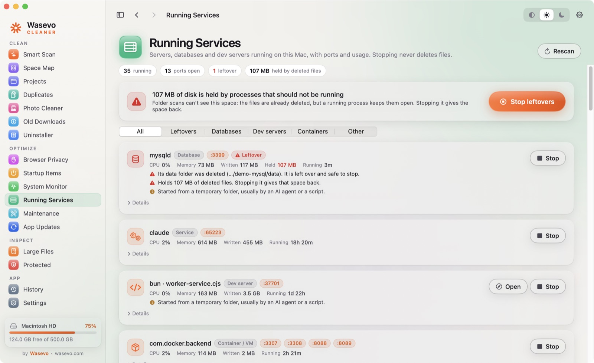
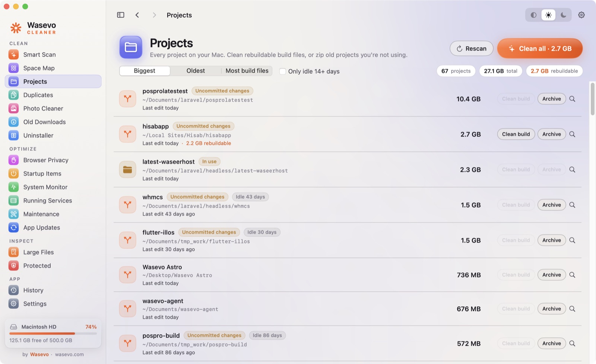
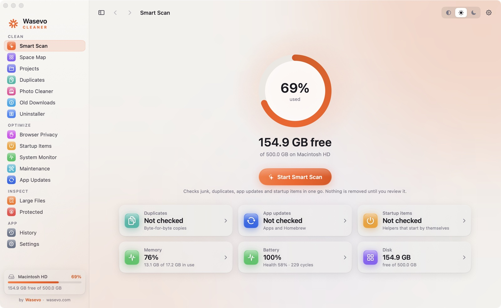
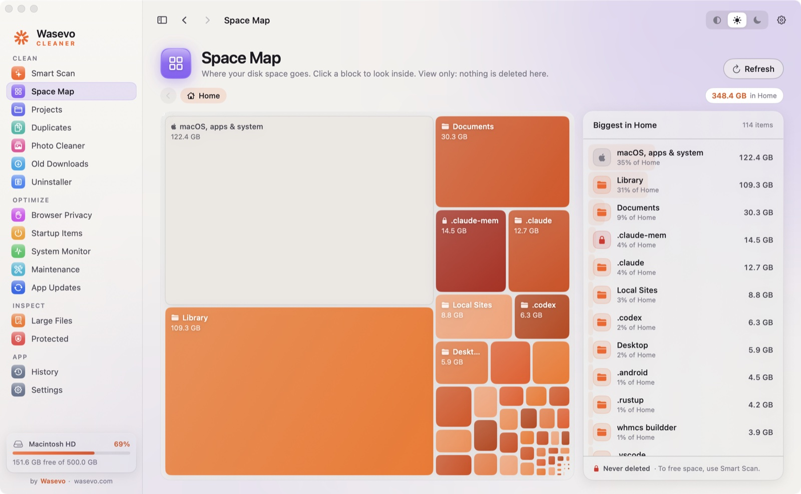
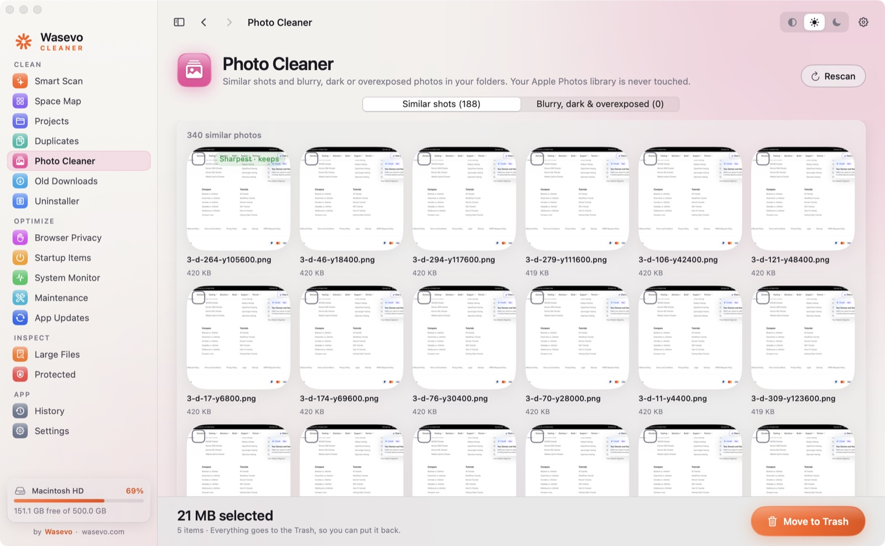
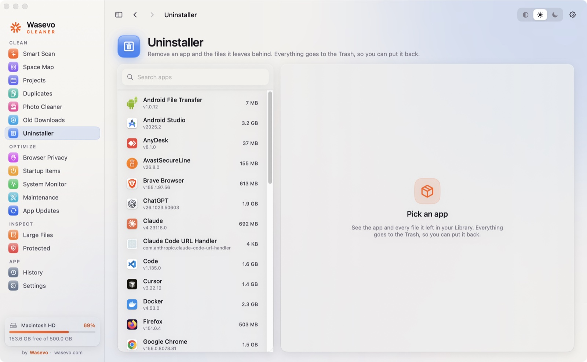
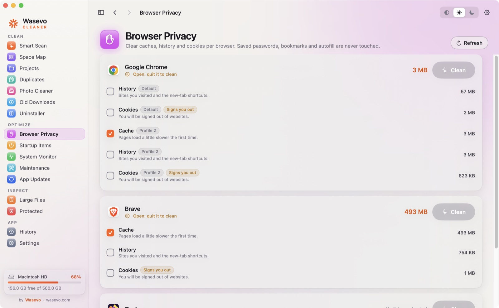
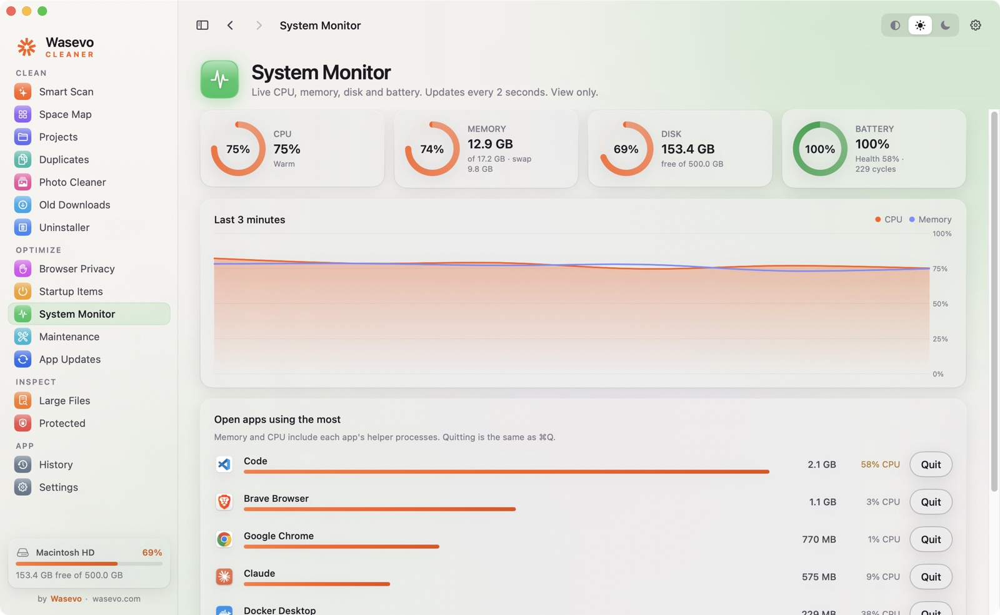
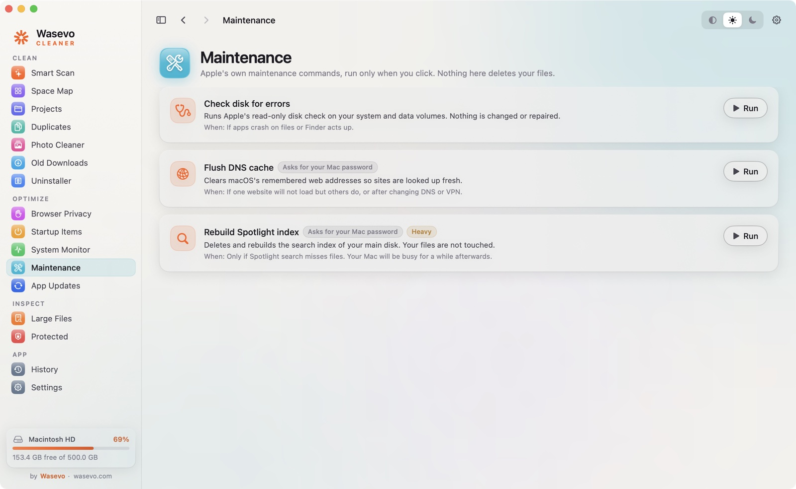
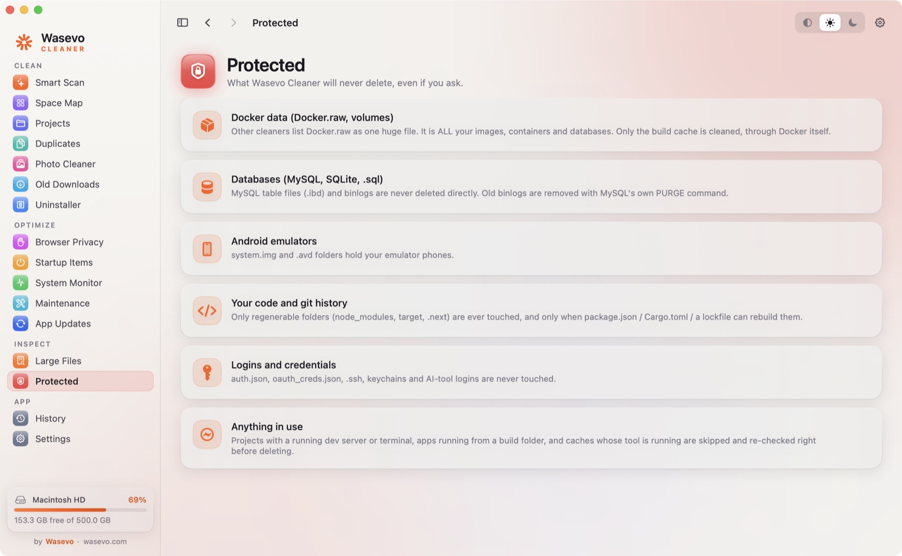

<p align="center"></p>

<h1 align="center">Wasevo Cleaner: free, open-source Mac cleaner</h1>

<p align="center">
<b>Free up disk space on macOS without deleting what matters.</b><br>
A safe, native Mac cleaner and storage optimizer for everyone, with extra care for developers.<br>
Smart Scan, duplicate finder, similar photo cleaner, app uninstaller, startup items, system monitor and more, in one app.
</p>

<p align="center">
<a href="https://github.com/Waqasahmedwaseer/wasevo-cleaner/releases/latest"></a>
<a href="https://github.com/Waqasahmedwaseer/wasevo-cleaner/releases"></a>
<a href="LICENSE"></a>

</p>

<p align="center"></p>

<p align="center"><a href="https://github.com/Waqasahmedwaseer/wasevo-cleaner/releases/latest">Download the latest release</a> · <a href="https://wasevo.com">wasevo.com</a></p>

---

## What's new in 0.6.0

- **Running Services.** Every local server, database, dev server and container with its ports, CPU, memory and disk writes. It flags **leftovers**: processes running from a deleted folder, or still holding deleted files. That space is used, but it is in no folder, so no disk scanner can see it. One click stops them, and a background check warns you when 2 GB or more is held.
- **Clean all projects in one click.** Remove the rebuildable build files of every project at once, or only projects idle 14+ days. Supports node_modules, Rust `target`, PHP `vendor`, Python `.venv`, Gradle, Swift, Flutter, CocoaPods, Nuxt, Angular, Parcel, Expo, Elixir, Zig and CMake.
- **Old editor extension versions.** VS Code, Cursor and Windsurf keep versions they already replaced; often gigabytes.
- **One-click verified updates** from GitHub Releases, plus a Homebrew cask.

[Full release notes](https://github.com/Waqasahmedwaseer/wasevo-cleaner/releases/tag/v0.6.0) · [The story behind it: my Mac lost 95 GB overnight](https://www.linkedin.com/pulse/my-mac-lost-95-gb-overnight-cleaner-could-find-heres-why-waseer-t818f/)

## Why Wasevo Cleaner

"Storage almost full" on a Mac usually has a few real causes: old project build folders, package-manager caches, duplicate downloads, near-identical photos, apps you deleted that left gigabytes behind, caches from AI tools, and processes that keep deleted files open (the space macOS often lumps into "System Data"). Most Mac cleaners either miss these or are far too eager, offering to delete things like your Docker data, database files or Android emulators as "junk".

Wasevo Cleaner is built the other way round:

- **Nothing is removed until you review it.** Every tool shows exactly what it found, with real sizes, and you choose.
- **An allow-list, not a guess.** Only known, regenerable locations are ever offered. Docker data, databases, emulators, `.git`, credentials and logins are hard-blocked.
- **Undoable.** Personal files always go to the Trash, and every action is written to a log.
- **Free and open source.** No subscription, no account, no tracking. Read every line of code that touches your disk.

## Features

### Clean
| Tool | What it does |
|---|---|
| **Smart Scan** | One click checks junk, caches, duplicates, app updates and startup items, grouped into categories you can tick on and off. |
| **Space Map** | A treemap of your home folder. Click any block to see exactly where your disk space went. View only. |
| **Projects** | Every code project with its size, last edit and git status. **Clean all** rebuildable build files in one click (or only projects idle 14+ days): `node_modules`, Rust `target`, `.next`, PHP `vendor`, Python `.venv`, Gradle `build`, Swift `.build`, Flutter, CocoaPods and more. Or zip an old project to `~/Wasevo Archives`. |
| **Duplicates** | Finds files that are byte-for-byte identical in Downloads, Desktop, Documents, Pictures, Movies and Music. Keeps the oldest or newest copy, your choice. |
| **Photo Cleaner** | Groups similar shots and keeps the sharpest one, and finds blurry, very dark or overexposed photos. Click any photo to preview it. Your Apple Photos library is never touched. |
| **Old Downloads** | Large downloads you haven't opened in months. |
| **Uninstaller** | Removes an app plus the caches, settings and containers it leaves behind. Always to the Trash, never while the app is running, never Apple apps. |

### Optimize
| Tool | What it does |
|---|---|
| **Browser Privacy** | Clear cache, history and cookies per browser and per profile (Chrome, Brave, Edge, Arc, Vivaldi, Firefox). Saved passwords, bookmarks and autofill are never touched. |
| **Startup Items** | Helpers and agents that start by themselves. Turning one off is fully reversible. |
| **System Monitor** | Live CPU, memory, disk and battery health, plus the apps using the most. |
| **Running Services** | Every local server, database, dev server and container with its ports, CPU, memory and disk writes. Finds **leftovers**: processes whose folder was deleted, or that still hold deleted files (space no folder scan can see). Stop them in one click. |
| **Maintenance** | Apple's own maintenance commands in one click: check disk, flush DNS cache, rebuild the Spotlight index. |
| **App Updates** | Which apps (App Store and Homebrew) have a newer version. |

### Inspect
| Tool | What it does |
|---|---|
| **Large Files** | Your biggest files with their real on-disk size (sparse files like `Docker.raw` show what they really use). View only, with warnings on files you must keep. |
| **Protected** | The full list of what Wasevo Cleaner will never delete, even if you ask. |
| **History** | Every deletion, trash and skip, logged to `~/Library/Logs/WasevoCleaner.log`. |

**Also:** one-click updates from GitHub Releases, Quick Look preview for photos and files (click a thumbnail or the eye button, use the arrow keys to browse a group), undo, keyboard shortcuts, light and dark themes, a menu-bar free-space monitor, and optional daily or weekly auto-clean of Safe caches only.

## Screenshots

| Running Services | Projects |
|---|---|
|  |  |
| **Smart Scan** | **Space Map** |
|  |  |
| **Photo Cleaner** | **Uninstaller** |
|  |  |
| **Browser Privacy** | **System Monitor** |
|  |  |
| **Maintenance** | **Protected** |
|  |  |

## What it cleans

| Category | Items |
|---|---|
| System and app caches | `~/Library/Caches` (Apple caches skipped), Chrome on-device AI model, Google Updater downloads, VS Code installer cache, leftover browser update copies |
| Developer caches | npm, uv, Bun, Composer, Yarn, Cargo registry, shared Rust targets, Playwright and Puppeteer browsers, Gradle, Xcode DerivedData, Arduino archives, old VS Code / Cursor / Windsurf extension versions |
| Project build files | `node_modules`, `target`, `.next`, `.nuxt`, `.turbo`, `.svelte-kit`, PHP `vendor`, Python `.venv`, Gradle `build`, Swift `.build`, Flutter `build` / `.dart_tool`, CocoaPods `Pods`, Nuxt `.output`, Angular / Parcel / Expo caches, Elixir, Zig, CMake (only when the lockfile or project file that rebuilds them is there, and never when committed to git) |
| AI tools | Claude, Cursor and Windsurf caches, Gemini CLI temp files, old Claude Code and Codex sessions (opt-in), Hugging Face models unused for 90+ days (opt-in) |
| Downloads and logs | Crash reports older than 7 days, old `.dmg` and `.pkg` installers (opt-in) |
| Tool-native cleanups | Docker build cache, `pnpm store prune`, `brew cleanup`, MySQL binary logs (opt-in), unavailable Xcode simulators (opt-in), Go module cache (opt-in), Dart / Flutter package cache (opt-in) |

## Install

### Download (recommended)

1. Download `Wasevo-Cleaner-<version>.dmg` from the [latest release](https://github.com/Waqasahmedwaseer/wasevo-cleaner/releases/latest).
2. Open it and drag **Wasevo Cleaner** into **Applications**.
3. The app is not notarized yet, so the first time, right-click the app, choose **Open**, then **Open** again.
4. For a complete scan, allow **Full Disk Access** when the app asks (System Settings, Privacy & Security). It works without it but sees less.

Requires macOS 13 Ventura or later.

### Homebrew

```bash
brew tap waqasahmedwaseer/wasevo-cleaner https://github.com/Waqasahmedwaseer/wasevo-cleaner
brew install --cask wasevo-cleaner
```

The first launch needs the same right-click, **Open** as the DMG until releases are notarized.

### Updates

Wasevo Cleaner checks GitHub Releases on launch and once a day, and shows **Update available** in the sidebar. One click downloads the new version, checks it against the SHA-256 GitHub publishes, confirms it is really Wasevo Cleaner and really newer, then swaps it in and relaunches. You can turn automatic checks off or skip a version in **Settings**.

### Build from source

Requires Xcode Command Line Tools (`xcode-select --install`).

```bash
git clone https://github.com/Waqasahmedwaseer/wasevo-cleaner.git
cd wasevo-cleaner
scripts/build-app.sh --install    # builds and opens ~/Applications/Wasevo Cleaner.app
scripts/make-dmg.sh               # optional: builds the drag-to-install DMG in dist/
```

## Safety model

1. **Allow-list, not block-list.** Only paths in the rule registry (`Sources/WasevoCleaner/Engine/Rules.swift`) or verified build folders are ever candidates.
2. **Hard protections.** `isSafeTarget()` refuses home, Documents and Desktop roots, `.git`, and everything matched by `protectedReason()`, even if a rule is wrong.
3. **Rebuild guard.** Every build folder needs the file that rebuilds it: `node_modules` a lockfile, `target` a `Cargo.toml`, PHP `vendor` a `composer.lock`, Python `.venv` a uv/poetry/pipenv/pdm lockfile, Gradle `build` a `build.gradle`. A build folder committed to git is never offered.
4. **In-use detection.** Projects with a running dev server or open terminal, apps running from a build folder, and caches whose tool is running are skipped, and everything is re-checked right before deleting.
5. **Tools clean themselves.** Docker, MySQL, pnpm and Homebrew are cleaned through their own commands, never by deleting their files. Docker volumes are never wiped.
6. **Personal files go to the Trash.** Duplicates, photos, downloads and uninstalled apps can always be put back.
7. **Stopping is not deleting.** Running Services only stops your own processes, asks them to quit first (Force stop only if they ignore it), re-checks the process is still the same program, never touches macOS system processes and never deletes a file.

## FAQ

**Is Wasevo Cleaner a free alternative to CleanMyMac or DaisyDisk?**
It covers the same everyday jobs (cache and junk cleanup, a disk usage map, duplicate and similar photo finder, app uninstaller, startup items, system monitor) for free, and adds developer-aware cleanup those apps don't do. It is MIT licensed, with no subscription.

**How do I free up disk space on my Mac safely?**
Open Wasevo Cleaner, click **Start Smart Scan**, review the categories, untick anything you want to keep, and clean. Then check Space Map, Projects and Duplicates for the biggest wins. Nothing is removed until you confirm it.

**How do I clear System Data on my Mac?**
System Data is the space macOS can't put in a category: caches, logs, developer build files, app leftovers, and space held by processes that should have stopped. Smart Scan clears safe caches and logs, Projects clears build folders, the Uninstaller removes app leftovers, and Running Services finds processes that still hold deleted files.

**Why did my Mac's storage fill up overnight?**
Usually something kept writing while you slept: a log, a local database, a backup or a sync tool. If the space is gone and no tool can find the files, a process may be holding deleted files open. Run `lsof -nP +L1` in Terminal, or open **Running Services**, which flags these automatically.

**How do I find which process is using a port?**
Open **Running Services**. Every listening port is shown next to its process, with a Stop button.

**Will it delete my Docker images, databases or emulators?**
No. Docker data (`Docker.raw` and volumes), database files, Android emulators, `.git` folders, credentials and AI-tool logins are on the protected list and can't be deleted from the app.

**Does it touch my Apple Photos library?**
No. Photo Cleaner only looks at image files in your normal folders.

**Does it send any data anywhere?**
No. There is no account, analytics or upload. Everything runs locally on your Mac. The only network request is the daily update check against GitHub, which you can turn off.

## Contributing

Issues and pull requests are welcome. A new cache location is one entry in `CACHE_RULES`, and a new kind of project build folder is one entry in `BUILD_RULES`; please include where it lives, what regenerates it, and which process uses it. Run the self-tests with `swift build && .build/debug/WasevoCleaner --selftest`.

```
Sources/WasevoCleaner/
  Engine/   Rules (registry and protections), Scanner (build-folder rules), Cleaner, SpaceMap, Projects,
            Duplicates, Photos, Uninstaller, Browsers, LoginItems, Maintenance, Monitor, Services,
            Updates, SelfUpdate, Undo, AutoClean
  App/      WasevoCleanerApp, Store, Theme, Navigation, Activity, SelfTest
  Views/    RootView, Dashboard, ScanView, SpaceMapView, ProjectsView, ServicesView, DuplicatesView,
            PhotosView, UninstallerView, PrivacyViews, SystemViews, UpdateViews, Preview, OtherViews
```

## Roadmap

- Signed and notarized releases
- More AI-tool and package-manager cache rules
- Agent worktrees: offer clean, merged `.claude/worktrees` checkouts
- "Disk grew" alerts: which folder grew since yesterday
- Old Node (nvm) versions, Rust toolchains and iOS simulator runtimes, shown for review

## License

[MIT](LICENSE) © Wasevo. Designed and built by Waqas Ahmed Waseer, Founder and CEO of [Wasevo](https://wasevo.com).

<sub>Mac cleaner · macOS cleaner · clear System Data on Mac · Mac storage full · running services · kill process on port · free up disk space on Mac · storage optimizer · disk cleanup · duplicate file finder · similar photo cleaner · app uninstaller · startup items · system monitor · clear browser cache · developer disk cleaner · node_modules cleaner · CleanMyMac alternative · open source</sub>
